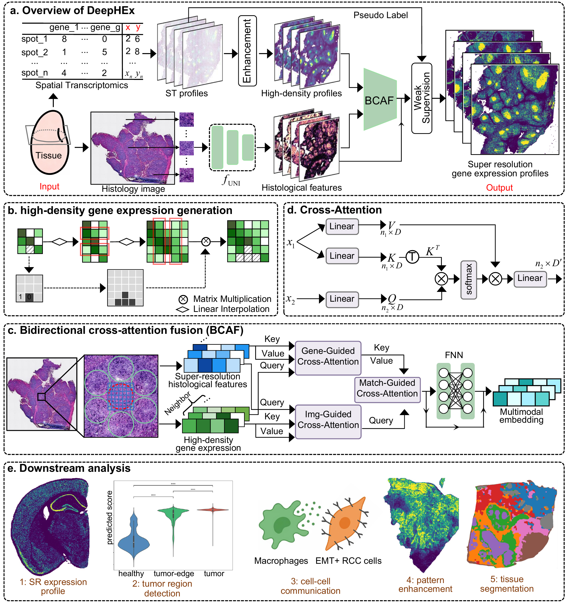

# DeepHEx enables expression-guided multimodal reconstruction of native tissue architecture and biological landscapes


## Overview

DeepHEx is a multi-modal deep learning framework designed to achieve high-resolution reconstruction of gene expression profiles by integrating histology images with spot-based spatial transcriptomics (ST) data within their native spatial context. By leveraging a self-supervised pathology foundation model and a bidirectional cross-attention mechanism, DeepHEx empowers high-fidelity biological insights, ranging from the identification of tissue architectures and tumor regions to the elucidation of cellular interactions and spatially variable gene patterns.




## Data
The datasets used in this paper can be downloaded from url：[https://zenodo.org/records/18153987](https://zenodo.org/records/18153987).

## Installation
All experiments were conducted on a single NVIDIA GeForce RTX 3090 GPU. The software has been tested and is compatible with both Windows and Linux operating systems.

1. Clone repository:

```bash
git clone https://github.com/wenwenmin/DeepHEx.git
```

2. Create virtual environment:

```bash
conda create --name deephex python=3.11
```

3. Activate virtual environment:

```bash
conda activate deephex
```

4. Install dependencies:

```bash
cd DeepHEx
pip install -r requirements.txt
```


## Repository Structure

```text
DeepHEx/
├── configs/      # Experiment configurations (YAML)
├── data/         # Data preprocessing and Dataset classes
├── model/        # feature extraction, expression enhancement, and core network
├── utils/        # Training engines and general utilities
├── notebooks/    # Step-by-step standard Visium and Visium HD tutorials
├── scripts/      # Environment check, data download and preprocessing commands
├── interface.py  # Main script bridging data preprocessing and model training
└── pipeline.py   # Main script for model training
```


## Running DeepHEx

Once your environment is set up, follow these three steps to ignite the process:

### 1. Request UNI Access & Token

DeepHEx utilizes the **UNI** pathology foundation model for histological feature extraction.

* Request access to the UNI model on [https://huggingface.co/mahmoodlab/UNI](https://huggingface.co/mahmoodlab/UNI).
* Generate your Hugging Face Access Token.
* Export the token as an environment variable so credentials are not stored in the repository:

```bash
export HF_TOKEN="your_huggingface_token_here"
```

## Workflow at a glance

| Step | Input and operation | Output |
| --- | --- | --- |
| Prepare input | Load a Space Ranger `outs` directory, select in-tissue spots and highly variable genes, rescale the histology image, and create a tissue mask. | Spatial coordinates, selected expression matrix, aligned image, and tissue mask. |
| Extract features | Apply the pretrained UNI model to histology patches. | Histological features on the superpixel grid. |
| Enhance expression | Interpolate the spot-based expression profiles. | High-density expression profiles for multimodal fusion. |
| Train and reconstruct | Train DeepHEx using histological features and high-density expression profiles, then run inference. | Superpixel-level expression estimates. |
| Export and inspect | Export expression and coordinates, and visualize the reconstructed profiles. | An `.h5ad` expression matrix, coordinates, run metadata, and visualizations. |

The standard Visium configuration uses 0.5 µm per pixel, 16-pixel superpixels, up to 1,000 highly variable genes, six neighboring expression locations, a 256-dimensional BCAF embedding, and 400 training epochs with a learning rate of 0.0001. These values can be changed in `configs/config_visium.yaml`. The tutorials explain the input files, intermediate results, and available configuration options.

## Standard Visium quick start

The standard Visium adapter accepts a Space Ranger `outs` directory containing `filtered_feature_bc_matrix.h5`, `spatial/tissue_positions.csv`, `spatial/scalefactors_json.json`, and `spatial/tissue_hires_image.png`. The tutorial [notebooks/DeepHEx_standard_Visium_tutorial.ipynb](notebooks/DeepHEx_standard_Visium_tutorial.ipynb) explains and runs each stage separately.

Copy `configs/config_visium.yaml`, update `directory` and `outs_dir`, then run:

```bash
python interface.py --config configs/config_visium.yaml --input-type visium
```

To prepare the input files without training:

```bash
python scripts/prepare_visium.py \
  --outs /path/to/spaceranger/outs \
  --output-dir /path/to/deephex-output
```

The final result is written to `deephex_expression.h5ad`, with matching `deephex_coordinates.csv` and `run_metadata.json`. The h5ad matrix has superpixels in rows and selected genes in columns; spatial coordinates are stored in `obs`.

The public tutorial dataset is the 10x Genomics **Human Cervical Cancer (FFPE)** sample: <https://www.10xgenomics.com/datasets/human-cervical-cancer-1-standard>.

The notebook downloads this public sample automatically. The same files can be prepared on the command line with:

```bash
python scripts/download_example_visium.py \
  --dataset human_cervical_cancer_1 \
  --output-dir example_data/visium_human_cervical_cancer_1
```

The repository also includes the tested `mouse_brain_sagittal_anterior` preset.

Set `USE_PUBLIC_EXAMPLE = False` in the notebook and provide `USER_SPACERANGER_OUTS` when running your own Space Ranger output.


### 2. Prepare Visium HD data

We take the simulation experiment based on Visium HD data as an example. Please download the demo dataset from the [10x Genomics official website](https://www.10xgenomics.com/datasets/visium-hd-cytassist-gene-expression-libraries-of-mouse-brain-he):

The Visium HD tutorial is [notebooks/DeepHEx_Visium_HD_tutorial.ipynb](notebooks/DeepHEx_Visium_HD_tutorial.ipynb). By default, it validates the preprocessed mouse brain inputs, uses an existing checkpoint for inference, exports the result, and compares reconstructed expression with the ground truth. Optional steps cover rebuilding intermediate inputs and training a model.

1.  **Raw ST Data**: Navigate to the **Output and supplemental files** section and download **Binned outputs (all bin levels)**.
2.  **Raw Histology Image**: Navigate to the **Input files** section and download the **Microscope image**.

**Key Path Definitions:**

* **`directory`**: This is the absolute path to the sample root folder, used to store the raw data and all generated data.
* **`sample_size`**: This refers to the specific folder containing your raw ST data (e.g., Square_8um).
* **`raw_image_name`**: The filename of your histology image.

**Required File Structure:**

```text
/home/data/                 <-- Root folder (directory)
├── Square_8um/             <-- Raw ST data (sample_size)
└── sample_he.tif           <-- Raw histology image (raw_image_name)
```

**Update your YAML configuration:**
Edit `configs/config_demo.yaml` to match your local paths:

```yaml
global:
  directory: "your_root_folder"  # e.g., /home/data/

preprocessing:
  visium_hd:
    sample_size: "your_raw_visiumhd_data"        # e.g., square_008um
    raw_image_name: "your_raw_histology_image"  # e.g., Visium_HD_Mouse_Brain_tissue_image.tif
```

### 3. Execution

With the configuration ready, launch the integrated preprocessing and training workflow by running `interface.py`:

```bash
python interface.py --config configs/config_demo.yaml
```

---

> **Note**: For large-scale datasets or multiple states, you can adjust the `n_states` and `gpu_ids` in the YAML file to optimize performance.

### 4. Demo
In addition, we also provide preprocessed data in the Zenodo database: [https://zenodo.org/records/18153987](https://zenodo.org/records/18153987). After updating the directory field in the YAML configuration file, the pipeline can be executed by running `interface_Demo.py`:

```bash
python interface_Demo.py --config configs/config_demo.yaml
```

## Contact details

If you have any questions, please contact xueshuailin@gmail.com and minwenwen@ynu.edu.cn.

## License

This project is covered under the GPL-3.0 license.

